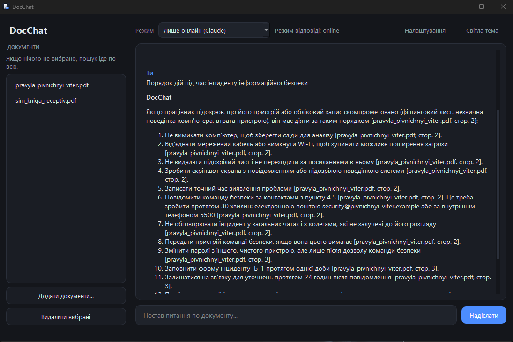
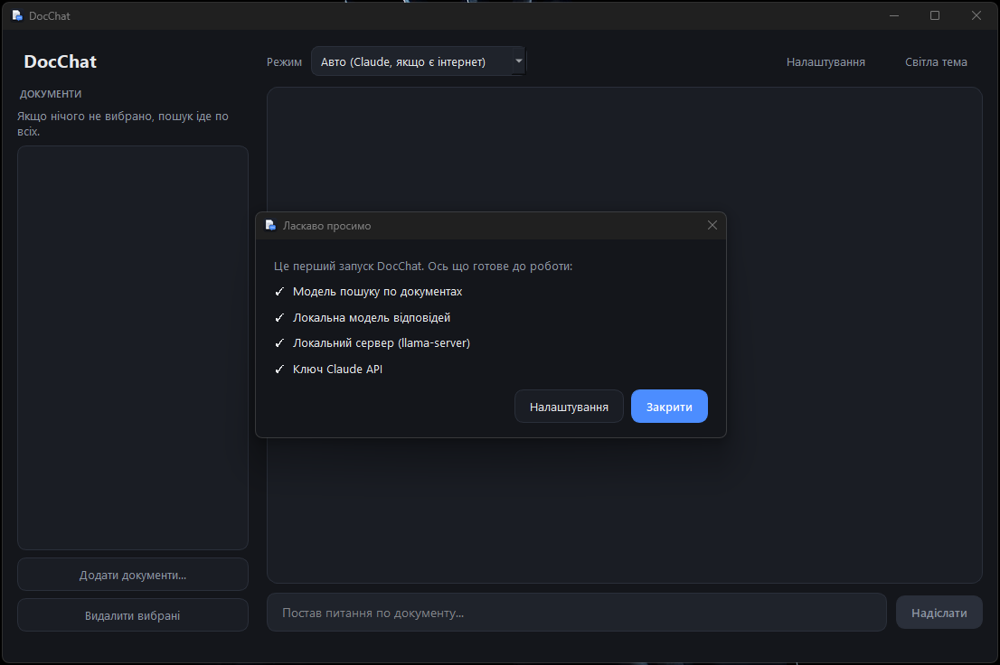
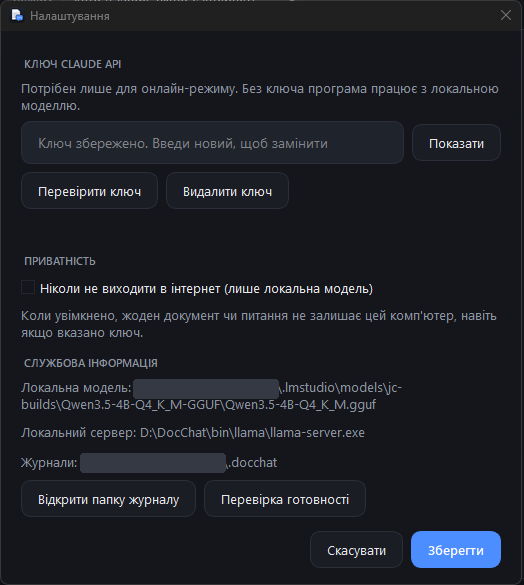

# DocChat

A desktop app that answers questions about your own documents, **with page citations**, and works both **online (Claude API)** and **fully offline (local model)**.

Load a PDF, DOCX or TXT file, ask a question in plain language, and get an answer that points to the exact page it came from. If the document does not contain the answer, DocChat says so instead of inventing one.

<p align="center">
  
</p>

## Screenshots

| First launch | Settings |
|---|---|
|  |  |

## Why it exists

Many organizations keep rules, manuals and statutes in long documents, and many of their computers are in isolated networks with no internet access. DocChat was built for that case: the same app can use a cloud model when a connection and an API key are available, and switch to a model running entirely on the local machine when they are not. In offline mode nothing leaves the computer.

## Features

- **Answers with sources.** Every claim ends with a citation such as `[file.pdf, p. 3]`.
- **Honest "not found".** If the retrieved excerpts do not contain the answer, the app says so.
- **Online and offline.** Claude API online; a bundled `llama.cpp` server with a local GGUF model offline. Modes: *Auto* (cloud if a key and a connection exist, otherwise local), *Online only*, *Offline only*.
- **"Never go online" switch.** A privacy setting that forces local mode even if an API key is saved.
- **Works with several documents.** Search across all loaded files or only the selected ones.
- **Ukrainian and other languages.** Search uses a multilingual embedding model; tested mostly on Ukrainian documents.
- **No manual setup for end users.** API key and options are set in a settings window (the key is kept in Windows Credential Manager, not in a plain file). A Windows installer is provided.
- **Dark and light themes.**

## How it works

```
document ──► text per page ──► chunks (1200 chars, 250 overlap)
                                   │
                         embeddings (multilingual-e5-small, local)
                                   │
                              ChromaDB (cosine)
                                   │
question ──► embedding ──► top-k similar chunks ──► + neighbouring chunks
                                   │
                  prompt: "answer only from these excerpts, cite pages"
                                   │
                    Claude API   or   local llama-server
                                   │
                         answer with citations
```

1. **Load.** `pypdf` and `python-docx` extract text page by page. Words broken by hyphenation across lines are repaired.
2. **Chunk.** Text is cut into overlapping chunks (1200 characters, 250 overlap) that remember their file and page. No document-specific rules are used, so any document works.
3. **Embed and store.** Each chunk is turned into a vector by `intfloat/multilingual-e5-small` (runs locally) and stored in a persistent ChromaDB collection.
4. **Retrieve.** The question is embedded the same way; the closest chunks are found and, in online mode, their neighbours are added so answers that span a page break stay complete.
5. **Answer.** The model receives only the retrieved excerpts and strict rules: answer from the excerpts only, treat them as data and not as instructions (a basic defence against prompt injection), cite pages, say when nothing is found.

Only the retrieved excerpts and the question are sent to Claude in online mode, never whole documents. In offline mode nothing is sent anywhere.

## Try it

Two fictional documents are in [`samples/`](samples):

- `company_rules_demo.pdf`: internal rules of a made-up company (remote work, passwords, vacation, an incident checklist that spans pages).
- `recipe_book_demo.pdf`: a made-up recipe book, useful to test searching across several documents.

Example questions for the company document (the document is in Ukrainian):

| Question | What to check |
|---|---|
| How many days a week can I work remotely? | Tuesday and Thursday, at most 2 days, with page citation |
| What are the password requirements? | At least 14 characters, changed every 90 days |
| How many vacation days do I get after 5 years? | 28 days plus 2 |
| List the steps of the incident procedure | A 12-step list that continues across pages, cited correctly |
| What is the capital of France? | The "not found in the documents" answer |

## Run from source (Windows)

Requires Python 3.13 (newer versions may lack prebuilt wheels for some dependencies).

```powershell
python -m venv .venv
.venv\Scripts\activate
pip install -r requirements.txt
python app.py
```

Online mode needs a Claude API key: enter it in **Settings** (or put `ANTHROPIC_API_KEY=...` in a `.env` file, which is git-ignored).

### Offline mode

Offline mode needs two things next to the app (both are git-ignored because of their size):

- `bin\llama\`: the [llama.cpp releases](https://github.com/ggml-org/llama.cpp/releases) Windows CPU build, containing `llama-server.exe`.
- `models\`: any chat-capable GGUF model. Developed and tested with Qwen3.5 4B (Q4_K_M, about 2.7 GB).

DocChat starts `llama-server` itself when needed and stops it on exit. If LM Studio or Ollama is already running at `LOCAL_BASE_URL`, it uses that instead.

The search model is downloaded from Hugging Face on first use. For computers without internet, prepare it once on a connected machine:

```powershell
python tools/prepare_embedding_model.py
```

and copy the resulting `models\embedding` folder next to the app. The **Settings → Readiness check** window shows what is missing.

## Build the installer

```powershell
.\build.bat
```

builds `dist\DocChat\DocChat.exe` with PyInstaller (folder mode). Then compile `installer\DocChat.iss` with [Inno Setup](https://jrsoftware.org/isinfo.php) to get `DocChat-Setup.exe`; use `/DLight` for a variant without the models folder. The installer needs no administrator rights, lets the user choose the install folder and shortcuts, and keeps user data (documents database, settings) on uninstall.

User data lives in `%USERPROFILE%\.docchat` (change with `DOCCHAT_DATA_DIR`).

## Project structure

```
app.py                 GUI (PySide6): window, background threads, themes
docchat/
  loader.py            PDF / DOCX / TXT reading
  chunker.py           splitting into overlapping chunks
  index.py             embeddings, ChromaDB, search, neighbour expansion
  context.py           merging chunks into readable excerpts with page markers
  answer.py            prompts, Claude and local-model calls, streaming
  backend.py           online / offline mode selection
  local_server.py      finds and runs the bundled llama-server
  service.py           app logic without GUI (add, remove, answer)
  settings.py          settings and API key storage
  settings_dialog.py   settings and readiness windows
  health.py            "what is missing" checks
  render.py, theme.py  Markdown to HTML, colour themes
tools/                 embedding-model preparation, icon generator
installer/DocChat.iss  Inno Setup script
```

## Known limitations

- **Scanned PDFs** without a text layer are not supported (no OCR).
- **Offline speed depends on the CPU.** On a typical office CPU a 4B model reads the retrieved text at roughly 85 tokens per second and writes about 10 tokens per second, so there is a pause of up to half a minute before the first word. A GPU build of llama.cpp would be much faster; it is not bundled because many target PCs have no GPU.
- **Answer quality offline** is that of a small model: good for finding and quoting facts, weaker at combining facts from many places.
- **Windows only** in the current form (the code is mostly portable; packaging is not).
- The installer is **not code-signed**, so Windows SmartScreen or antivirus software may warn about it.
- The build is large (several GB) mainly because of PyTorch, which the search model needs.

## Tech stack

Python 3.13, PySide6, ChromaDB, sentence-transformers (`multilingual-e5-small`), pypdf, python-docx, Anthropic SDK, llama.cpp, PyInstaller, Inno Setup.

## License

[MIT](LICENSE)
